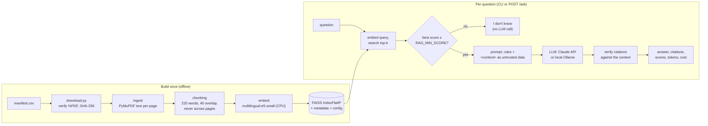

# RAG — multilingual question answering over public PDF reports

Answers questions about public reports (WMO *State of Global Water Resources* 2022–2025,
later Swiss federal documents) with **citations to document and page**, and says
**"I don't know"** when the reports don't support an answer. Runs as a CLI or a FastAPI
service, with Claude or a local Ollama model, and comes with an evaluation framework
(retrieval and answer metrics, LLM judge, prompt-injection tests).

## Architecture



Everything left of the gate runs on the CPU in a few milliseconds per question; the LLM
call dominates latency (about 2–3 s with `claude-haiku-5-5`). Logs and metrics record ids,
pages, scores and counts, never question, answer or document text.

## Quick start

```bash
uv sync                                   # create .venv and install dependencies
uv run python scripts/download.py         # PDFs from manifest.csv -> data/raw/
uv run python -m rag.ingest               # PDFs listed in manifest -> data/processed/pages.jsonl
uv run python -m rag.chunking             # pages.jsonl -> chunks.jsonl (+ chunks.config.json)
uv run python -m rag.index                # embed chunks -> data/processed/index/ (--force to rebuild)
uv run python scripts/export_text.py      # optional: pages.jsonl -> data/processed/text/*.txt
```

Ask a question (copy `.env.example` to `.env` and set `ANTHROPIC_API_KEY` first; `.env`
is git-ignored and never copied into the Docker image):

```bash
uv run python -m rag.search "How did glacier mass change?" --k 5      # retrieval only, free
uv run --env-file .env python -m rag.ask "How did glacier mass change in 2024?" --backend claude --k 5
```

## Running the API

```bash
uv run --env-file .env uvicorn rag.api:app --port 8000     # locally
docker compose up --build                                  # or in Docker
```

The image contains neither the index, the PDFs nor any key: the index holds text from
copyrighted reports, so Compose mounts `./data/processed` read-only. On first start the
container downloads the embedding model into the `hf-cache` volume (the healthcheck allows
3 minutes for this).

```bash
curl -s localhost:8000/health

curl -s -X POST localhost:8000/ask -H "Content-Type: application/json" \
  -d '{"question": "What share of river basins had normal conditions in 2024?", "k": 5}'

# backend override, and the API key header (needed only if RAG_API_KEY is set)
curl -s -X POST localhost:8000/ask -H "Content-Type: application/json" \
  -H "X-API-Key: $RAG_API_KEY" -d '{"question": "Wie stark schmolzen die Gletscher 2024?", "backend": "ollama"}'

curl -s localhost:8000/metrics | grep '^rag_'
```

| Endpoint | Purpose |
|---|---|
| `POST /ask` | `{question: 1–500 chars, k: 1–10 (default 5), backend: "claude"\|"ollama" (default RAG_BACKEND)}` → answer, citations with `verified`, retrieved chunks (doc, page, chunk id, score), backend, model, `latency_ms`, `refused`, tokens, cost. Errors: 401 bad/missing key, 422 invalid input, 503 backend unavailable, 504 LLM timeout. |
| `GET /health` | index loaded, number of chunks, embedding model, index build date, backends |
| `GET /metrics` | Prometheus: `rag_requests_total{endpoint,status}`, `rag_request_latency_seconds`, `rag_refusals_total{reason}`, `rag_unverified_citations_total`, `rag_llm_tokens_total{backend,direction}` |

All settings are environment variables, listed with defaults in `.env.example` and
`src/rag/config.py`.

**Image size: 1.66 GB** (`docker images rag`), of which PyTorch is 809 MB even with the
CPU-only wheel (`du -sm` inside the image). On Linux the lock takes torch from PyTorch's
CPU index (`2.15.0+cpu`), so no CUDA libraries are installed. The image runs as a
non-root user, and `/app` contains only the virtual environment.

## Evaluation

### Results

<!-- EVAL-TABLE:START (generated by python -m rag.eval.report; do not edit) -->
No reportable evaluation run yet. Run `python -m rag.eval.run`, then `python -m rag.eval.report`.
<!-- EVAL-TABLE:END -->

The block above is generated from the latest `results/*/summary.json` by
`uv run python -m rag.eval.report`, so numbers in this README are never typed by hand.
It stays empty until the evaluation questions have been verified by a person and a
Claude run has been made.

### How to run

```bash
uv run python -m rag.eval.validate                    # check every label against the PDF text
uv run python scripts/find_gold.py --check            # pages with an evidence quote missing from gold
uv run python -m rag.eval.threshold                   # calibrate RAG_MIN_SCORE on dev, report once on test (no LLM)
uv run --env-file .env python -m rag.eval.run --backend claude --k 5 --split test
uv run --env-file .env python -m rag.eval.judge api --run results/<run>      # faithfulness, judge = RAG_JUDGE_MODEL
uv run python -m rag.eval.judge export --run results/<run>                   # or judge elsewhere, then:
uv run python -m rag.eval.judge import --run results/<run> --file eval/judgments_<judge>.jsonl
uv run python -m rag.eval.judge agree eval/judgments_a.jsonl eval/judgments_b.jsonl
uv run python -m rag.eval.judge sample --run results/<run> --file eval/judgments_<judge>.jsonl
uv run --env-file .env python -m rag.eval.ablation --backend claude --split dev
uv run --env-file .env python -m rag.eval.injection --backend claude
uv run python -m rag.eval.report                      # refresh the table above
```

`--backend fake` runs any of these without an LLM or network (a dry run that cites the
top chunk), to check the plumbing; retrieval metrics are real even then. Each run writes
`results/<timestamp>/` with `config.json` (models, k, per-doc, threshold, embedding,
chunking, git commit), `outputs.jsonl` (per question: retrieved chunks and scores, answer,
citations, tokens, cost) and `summary.json` / `summary.md`.

### Questions (`eval/questions.jsonl`)

One JSON object per line: `id, question, language, type, gold_docs, gold_pages, answer,
evidence_snippet, author, verified, split` (plus optional `notes` and `difficulty`).
Types: `single_fact`, `number`, `cross_year`, `multi_hop`, `table` (a number in a table,
figure caption or chart label, including comparisons and aggregations across table rows),
and two types the system should **refuse**, because the answer is not in the extracted text:
- `unanswerable`: the reports don't contain the answer (no gold, `answer: null`);
- `figure_only`: the answer is visible only in a chart or map (bar heights, curves),
  which text extraction doesn't capture. These honesty tests keep the figure's page as
  gold, for a future multimodal pipeline, but have no text evidence.

Questions name the report year (the four editions repeat the same tables with different
numbers) but not the table or figure, as a real user wouldn't. Five questions also exist
as a `-ptr` variant that does name it ("According to Table A.5 …"), to measure how much
such a pointer helps retrieval.

**Only `verified: true` questions count in reported metrics**; LLM-drafted questions
(`author: "llm"`) stay unverified until a person checks them. The three questions used
while building the pipeline are in **dev**, because they were looked at repeatedly.

### Design choices

- **Labels are checked before metrics.** `rag.eval.validate` confirms each gold document
  and page exist and that the evidence quote is on a gold page (ignoring case, whitespace
  and hyphenation). A wrong label would otherwise silently distort every metric.
- **Two retrieval levels.** Page level (right report *and* page) and document level (right
  report, any page): "right report, wrong page" is a different failure from "wrong report".
  hit@k and MRR use a fixed top-10 retrieval, so they don't change with k.
  **Gold in context** (did a gold page reach the LLM?) is what k changes.
- **Refusals both ways.** Refusal accuracy is reported with the false-refusal rate on
  answerable questions and the share of unanswerable questions caught.
- **Citations: validity vs. correctness.** Validity = the cited page was in the context;
  correctness = the answer cites a gold page. Faithfulness (claims supported by the
  context) needs a judge.
- **Judge.** Sees the same escaped context as the generator, returns validated JSON
  (`supported` / `partially` / `unsupported` + unsupported claims); unparseable replies
  count as errors, not guesses. Refusals are not judged. Two judges can be compared with
  percent agreement and Cohen's kappa, and 10 verdicts sampled for a human check.
- **Threshold on dev only.** Candidates are midpoints between observed dev scores; the
  rule maximises unanswerable caught subject to a false-refusal limit; test is evaluated
  once with the chosen value. With no unanswerable dev questions it recommends nothing.
- **Uncertainty.** 95% bootstrap intervals (1000 resamples, seed 0) for hit@5, MRR,
  refusal accuracy and faithfulness. With a few dozen questions they are wide.
- **Injection tests without redistributing the reports.** `tests/poisoned/injections.json`
  holds only the attack specs; poisoned copies of three reports are built in memory and
  indexed in a separate in-memory index. A test with a model that obeys the injection
  proves the harness detects success. The rate counts only questions where a poisoned
  chunk actually reached the context.
- **Ablation** compares k = 3, 5, 10 and per-doc 1, 2 (per-doc ignores k). Chunk size is
  not varied yet: that needs a rebuilt index per setting.

### Early retrieval check (by hand, three questions)

Produced by `uv run python scripts/check_retrieval.py --k 5 --out eval/results/retrieval_stage2.json`
on the index with 220-word chunks (see `index_config` in that file). Gold pages were also
checked visually in the rendered PDFs.

| Question | Gold page rank (top 5) | Top-1 score | Gold hit score | Notes |
|---|---|---|---|---|
| q001 share of basins normal, 2024 | 2 | 0.889 | 0.887 | rank 1 is the 2024 key-messages page (related, not the figure) |
| q002 stations and countries, 2024 | 2 | 0.884 | 0.881 | rank 2 gives the station count only; the pages with "41 countries" rank 6, 7 and 15 |
| q003 glacier loss, 2023 vs 2024 | 1 | 0.889 | 0.889 | both editions' gold pages in the top 5 |

- **Scores are compressed:** every top hit falls between 0.88 and 0.89, and an unrelated
  query (`uv run python -m rag.search "test" --k 1`) scores 0.843, matching a
  table-of-contents page of dot leaders. A fixed "I don't know" threshold on the raw score
  separates poorly; it has to be calibrated with questions the reports cannot answer.
- **Other editions compete.** Questions naming a year also retrieve 2022, 2023 and 2025
  chunks. Candidate fixes: larger k, filtering by the manifest's `year`, a reranker.

## Privacy and operations

**Logged** (one JSON line per `/ask` request, to stderr): request id, timestamp, latency,
backend, model, k, retrieved document names and page numbers, top score, refused flag and
reason, token counts, number of unverified citations, and on failure the error type and status.

**Never logged:** the question, the answer, retrieved chunk text, API keys. This is
enforced by an allow-list in `rag/logging.py`: the formatter drops any field not on it,
and a test sends a marked question and answer through the API and asserts neither
appears in the captured logs. Uvicorn's access log is disabled in Docker, so client IP
addresses are not logged either.

**Where data does go:** with the `claude` backend, the question and retrieved excerpts
are sent to the Anthropic API. With `ollama`, everything stays on the machine running
Ollama. The `/ask` response returns the answer to the caller, and a 422 response echoes
the invalid input back to the caller (not to logs).

**Operations:**
- **`RAG_API_KEY` is demo-level access control**: one shared static key in a header
  (compared in constant time), no users, rotation, rate limiting or TLS. Put a real auth
  layer (API gateway, OAuth) and HTTPS in front for anything public.
- **CPU-bound work:** embedding the question and FAISS search run on the CPU; endpoints
  are plain `def`, so FastAPI runs them in a thread pool and a slow LLM call doesn't block
  other requests. One worker per container: each worker would load its own model and index.
- **Fail fast on a missing index** (startup fails and the healthcheck shows it); a
  missing backend only makes requests for that backend return 503.
- **Timeouts:** `RAG_LLM_TIMEOUT_S` (default 60 s) bounds an LLM call; exceeding it returns 504.

## Known limitations

- **No reportable evaluation numbers yet.** Most evaluation questions are LLM-drafted and
  still need a person to verify them; the threshold, the evaluation run and the judge run
  come after that.
- **Text only.** Charts and maps produce no text, so questions answerable only from a
  figure cannot be answered (the `figure_only` questions test that the system refuses).
  Tables are extracted cell by cell, one per line, so the link between a value and its row
  and column is lost; questions that need it are harder than they look.
- **Extraction order can differ from reading order.** PyMuPDF returns text in the order it
  is stored in the PDF; a heading drawn last (e.g. "Semi-decadal statement" on page 22 of the
  2025 report) ends up at the end of its page. Nothing is lost, and chunks never cross
  pages, but a heading can land in a different chunk from its paragraphs.
- **A "verified" citation is not a checked fact.** Verification only confirms that the
  cited document and page were among the chunks the model was shown. It does not check
  that the page *supports* the claim: a model could cite a real, retrieved page for a
  statement that page doesn't make, and it would still show as verified. Catching that
  needs the faithfulness judge (`rag.eval.judge`), itself an LLM that can be wrong:
  hence judge agreement and a human check of a sample.
- **Partial refusals are not detected.** `refused` is true only when the answer contains
  the exact "I don't know based on the provided documents." sentence. An answer that
  gives one fact and says it doesn't know another (in its own words) counts as answered.
- **The "I don't know" threshold is uncalibrated** until enough verified dev questions,
  including unanswerable ones, exist (`rag.eval.threshold` refuses to recommend one before).
- **Cross-lingual questions score lower.** A German or French question about an English
  report gets a lower retrieval score than an English one, so a single threshold refuses
  non-English questions first. Seen on earlier unverified drafts with
  `python -m rag.eval.threshold --include-unverified` (scores per question in its JSON).
- **Other editions compete in retrieval.** Year-specific questions also retrieve chunks
  from other years' reports, and some answers sit just outside the top 5.
- **Prompt-injection defences reduce risk but don't eliminate it.** `rag.eval.injection`
  measures the attack success rate on poisoned copies; few questions reach a poisoned
  chunk because the reports repeat facts on unpoisoned pages.
- **`-ptr` question pairs are not yet filtered.** Each pointer variant tests the same fact
  as its twin; headline metrics should count only one of them, which the runner does not
  do yet.
- **Flat gold format.** With several gold documents, every gold page counts for every gold
  document, so a page number that exists in the "wrong" report also counts as a hit.
- **Gold pages can be incomplete.** Reports repeat key facts (summary, chapter, annex), and
  hand labelling missed gold pages several times. Each question has an `evidence_snippet`,
  and `uv run python scripts/find_gold.py --check` lists every page in its gold documents
  containing it that is missing from gold. Phrases must be specific: a loose phrase matched
  an unrelated sentence. Facts worded differently, or split by hyphenation, can still be missed.
- **Reference lists are indexed too.** Bibliography sections become chunks like any other
  text and may match queries on keywords without containing the answer. Whether to filter
  them is for the evaluation to show.

## Design decisions

### Documents, pages and chunks

- **Ingest only what the manifest lists.** `rag.ingest` reads `manifest.csv` and fails
  if a listed PDF is missing, so stray or renamed files in `data/raw/` are never indexed.
- **Two page numbers per chunk.** Each chunk stores `page` (1-based position in the PDF
  file, which also appears in `chunk_id`) and `page_label` (the number printed on the page,
  read from the PDF's page-label table, e.g. `"xii"` or `"33"`). In the 2024 report, PDF
  page 47 is printed page 33. Citations show the printed label and fall back to the PDF
  page when `page_label` is `null` (the PDF defines no labels).
- **Chunks never cross pages,** so every citation points to exactly one page.
- **Chunk size vs. embedding model truncation.** Embedding models silently truncate input
  beyond their maximum sequence length (512 tokens for `multilingual-e5-small`), so the end
  of an over-long chunk is never embedded. Chunk size is measured in words as a proxy for
  tokens, and `python -m rag.index` counts the real tokens with the model's tokenizer and
  records `chunks_over_limit` in `data/processed/index/config.json`. A first build with
  300-word chunks left many over the limit, so chunks are now 220 words with a 40-word
  overlap; the remaining over-limit chunks are mostly reference lists, where URLs and DOIs
  split into many tokens. Run the index build to see the current numbers.
- **Chunk boundaries fall anywhere.** Chunks are fixed word windows, so a boundary can cut
  a sentence in half. The 40-word overlap means any passage shorter than that appears
  whole in at least one chunk.
- **Why not a model with a longer limit** (e.g. `BAAI/bge-m3`, 8192 tokens)? One vector per
  chunk blurs long chunks, smaller chunks give more precise citations, and a larger model
  is slower on CPU. A model comparison belongs in the evaluation.
- **Plain-text export.** `scripts/export_text.py` writes each report as
  `data/processed/text/<doc>_pp<start>-<end>.txt`, one file per fixed range of 20 PDF pages,
  with a `=== PAGE <n> ===` line before each page. **`<n>` is the PDF page index** (the
  `page` field in chunk metadata and chunk ids), **not the printed page number**: page 47
  of the 2024 report appears as `=== PAGE 47 ===` although "33" is printed on it. Pages with
  fewer than 200 characters are skipped. The files contain report text and are git-ignored.

### Embeddings and retrieval

- **e5 prefixes.** Documents are embedded as `"passage: <text>"`, queries as
  `"query: <text>"`; e5 was trained this way and retrieves worse without them.
- **Normalised vectors + `IndexFlatIP`.** The inner product of unit vectors is cosine
  similarity, so scores are comparable across queries (needed for the "I don't know"
  threshold). Flat = exact brute-force search, fine for a few thousand chunks.
- **The index records its own config.** Model name, chunking parameters and build date are
  saved next to the index. Search loads the model named there, never a code default,
  so queries and stored vectors always come from the same model.
- **Truncation and build time are measured at build time**, so both are known, not guessed.
- **Rebuild only on request.** `rag.index` refuses to overwrite an existing index without
  `--force`; search never builds an index and fails clearly if none exists.
- **`--per-doc M`** takes the best M chunks from each report, for questions that compare
  years. It is off by default.
- **Deliberately not yet:** a vector database (only worth it at millions of chunks or with
  frequent updates), a reranker (a cross-encoder rescoring the top-k, in `search.py`),
  hybrid search (BM25 + vectors, helps with exact terms like report numbers). Add these
  only if the evaluation shows a need.

### Answer generation

- **One small `LLMClient` interface** (`generate(system, user, max_tokens)`) with Claude,
  Ollama and a fake implementation. The pipeline doesn't know which backend it uses, and
  tests run the whole pipeline with the fake one. No framework (LangChain etc.): the
  pipeline is a handful of plain function calls.
- **The API key comes only from `ANTHROPIC_API_KEY`**, passed explicitly to the SDK so no
  other credential source is picked up. It is never stored in settings or printed, and
  error messages are written so they cannot contain it (tested). Locally, `.env`
  (git-ignored) is loaded by `uv run --env-file .env`; the code never reads the file.
- **Threshold before generation.** If the best retrieval score is below `RAG_MIN_SCORE`, the
  answer is "I don't know" and the LLM is not called: no grounding, no cost. The default
  (0.80) is a **placeholder** until it is calibrated on the dev split.
- **Prompt injection.** Retrieved text is placed inside `<context>`, declared untrusted
  data in both the system prompt and the block itself, and HTML-escaped so a document
  containing `</context>` cannot close the block early (tested). `rag.eval.injection`
  measures what still gets through.
- **Citations are checked, not trusted.** Every `[document, p.N]` in the answer must
  match a chunk the model was shown, or it is flagged as a possible hallucination.
- **Context budget** (`RAG_MAX_CONTEXT_TOKENS`) is filled with the highest-scoring chunks
  first, using a ~4 characters/token estimate. An exact count would need an API call.
- **Cost** is estimated from the response's real token counts and the price table in
  `config.py`; unknown models get no estimate rather than a guess.
- **`max_tokens` is generous (16000)** because Claude's thinking tokens count toward it; a
  low cap could cut the answer off. Only the tokens actually generated are billed.

## Development

```bash
uv run pytest                                 # all tests: no network, no model download, no PDFs
uv run ruff check . && uv run ruff format --check .
```

**Continuous integration** (`.github/workflows/ci.yml`) runs on every push and pull
request: ruff lint and format, the full test suite, and a Docker build. It needs no
secrets and no data: tests use a fake embedder and fake LLM, and the image doesn't contain
the index. `uv sync --frozen` makes CI fail if `uv.lock` is out of date, so it tests
exactly the locked versions.

**Linux vs. Intel Mac versions.** Docker and CI use current versions; an Intel Mac is
held back by PyTorch (see the platform note). From `uv.lock`:

| | Intel Mac (local dev) | Linux (Docker, CI) |
|---|---|---|
| torch | 2.2.2 | 2.15.0+cpu |
| numpy | 1.26.4 | 2.5.4 |
| transformers | 4.57.6 | 5.22.2 |
| sentence-transformers | 5.7.0 | 6.3.0 |

The test suite passes on both sets. CI covers Linux; to run it on Linux locally:

```bash
docker run --rm -v "$PWD":/work:ro -w /work -e UV_PROJECT_ENVIRONMENT=/tmp/venv \
  --entrypoint sh python:3.12-slim -c \
  'pip install -q uv && uv sync --frozen && /tmp/venv/bin/python -m pytest -q -p no:cacheprovider'
```

**Platform note: PyTorch on Intel Macs.** `sentence-transformers` runs on PyTorch, which
publishes no Intel-Mac (x86_64 macOS) builds after 2.2.2. `pyproject.toml` therefore
constrains `numpy<2` and `transformers<5` on Intel Macs only (`tool.uv.required-environments`
makes uv lock a working set for them). On the same machines, PyTorch and FAISS bundle
clashing OpenMP runtimes and embedding segfaults if FAISS loads first, so `rag/__init__.py`
loads PyTorch first there. Linux gets current versions, including numpy 2 (`numpy>=2` on
Linux). Side effect: uv prefers one numpy version where it can, so macOS on Apple Silicon
and Windows also get numpy 1.26.4; everything else there is current.

## Layout

```
manifest.csv            source documents (filename, title, year, language, publisher, url, licence_note)
scripts/download.py     download + verify PDFs (skips existing files, checks %PDF, prints SHA-256)
scripts/export_text.py  plain-text export, 20 pages per file, "=== PAGE <n> ===" markers
scripts/find_gold.py    search all pages for a phrase; --check finds gold pages that were missed
scripts/check_retrieval.py  early retrieval check vs gold pages
src/rag/manifest.py     manifest.csv reader shared by download and ingestion
src/rag/ingest.py       per-page text extraction with PyMuPDF (manifest files only)
src/rag/chunking.py     overlapping word-window chunks, never crossing pages
src/rag/embed.py        Embedder: multilingual-e5-small on CPU, e5 prefixes, normalised vectors
src/rag/index.py        build/save/load the FAISS index + metadata + config.json
src/rag/search.py       top-k search (and per-document search) with CLI
src/rag/config.py       settings from RAG_* env vars, Claude price table
src/rag/llm.py          LLMClient interface: ClaudeClient, OllamaClient, FakeLLMClient
src/rag/prompt.py       system prompt, <context> block with escaping, context budget
src/rag/citations.py    extract [doc, p.N] citations and check them against the context
src/rag/answer.py       pipeline: retrieve -> threshold -> generate -> verify
src/rag/ask.py          question-answering CLI
src/rag/api.py          FastAPI service: /ask, /health, /metrics
src/rag/logging.py      JSON logs with a field allow-list (no question/answer text)
src/rag/metrics.py      Prometheus counters and histogram
src/rag/jsonl.py        JSONL read/write helpers
src/rag/eval/           schema, validate, retrieval/answer metrics, judge, threshold, run,
                        ablation, injection, report (README table), stats (bootstrap)
eval/questions.jsonl    evaluation questions: answers, gold docs + pages, evidence, split
tests/                  pytest suite (generated PDFs, fake embedder and LLM: no network, no model)
tests/poisoned/         prompt-injection attack specs (no report text)
results/                evaluation runs: config, per-question outputs, summary
Dockerfile              multi-stage uv build, CPU-only PyTorch, non-root, healthcheck
docker-compose.yml      service + read-only index mount + model cache volume
.github/workflows/ci.yml  lint, tests and Docker build on every push
.env.example            every environment variable, no real values
data/raw/               downloaded PDFs (git-ignored)
data/processed/         generated JSONL, text export and index/ (git-ignored)
```

## Data and licences

PDFs and text extracted from them are not committed to this repository. Each document's
licence is noted in `manifest.csv`; run the download script to fetch them from the
publisher. The evaluation questions quote short extracts (at most 25 words) with their
document and page as the source.

## Stages

| Stage | Scope | Status |
|---|---|---|
| 1 | Scaffold, download, ingestion, chunking | done |
| 2 | Embeddings (`intfloat/multilingual-e5-small`, CPU) and a FAISS index | done |
| 3 | Retrieval + answer generation (Claude API, default `claude-haiku-5-5`, or local Ollama); refuse when retrieval scores are low | done (threshold not yet calibrated) |
| 4 | FastAPI service (`/ask`, `/health`, `/metrics`), logging latency and doc ids but never question text; Dockerfile | done |
| 5 | Evaluation: gold doc + page questions, hit@5, MRR, faithfulness with a configurable judge model, prompt-injection tests with poisoned documents | framework done; questions await human verification, no Claude run yet |
| 6 | GitHub Actions (ruff, pytest, docker build); README with architecture diagram, evaluation table, privacy section, limitations | done |
| next | Structured table extraction (PyMuPDF `find_tables`), then optional vision input for figures | not started |
